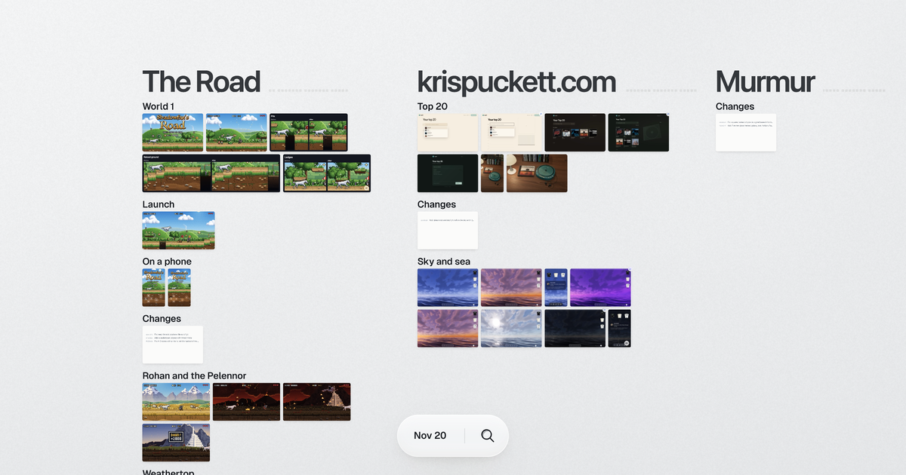
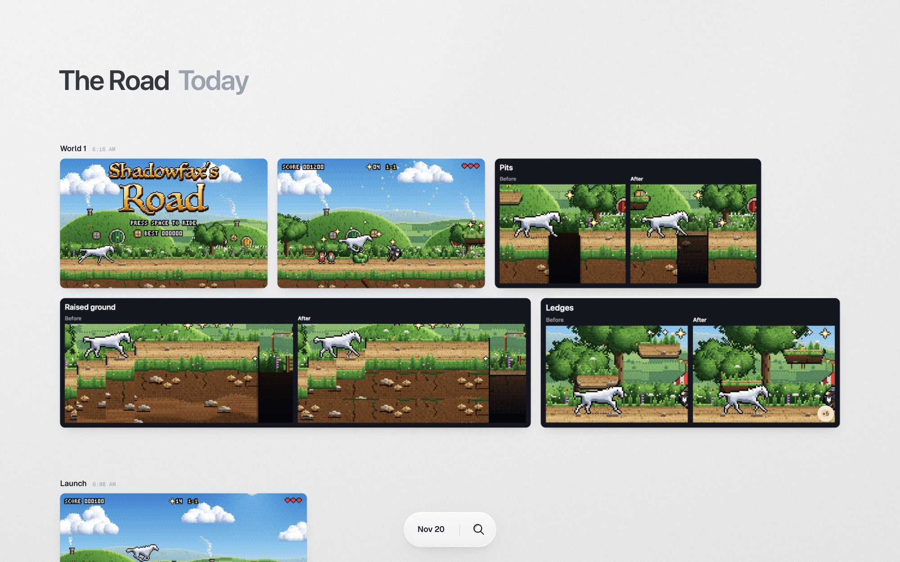
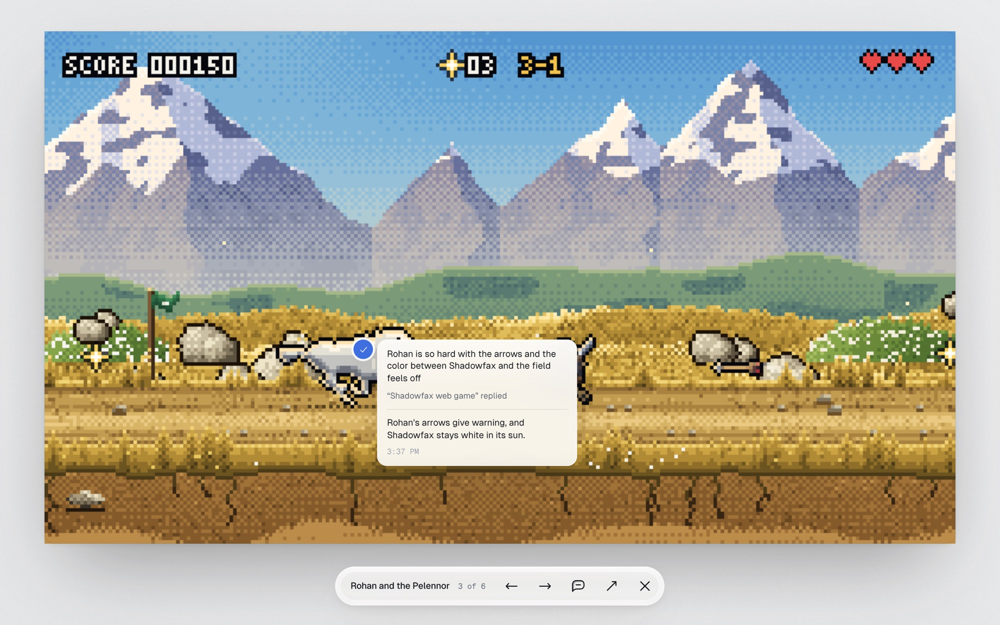
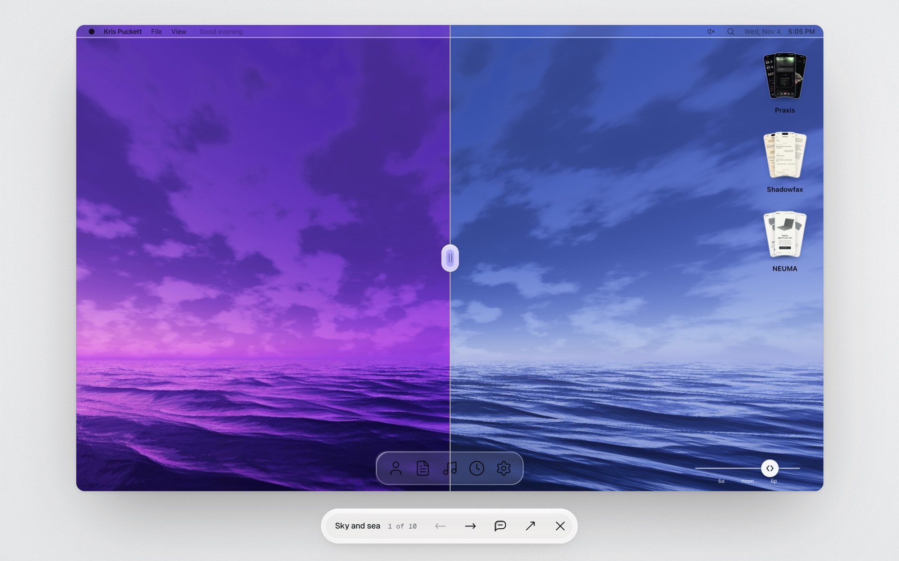
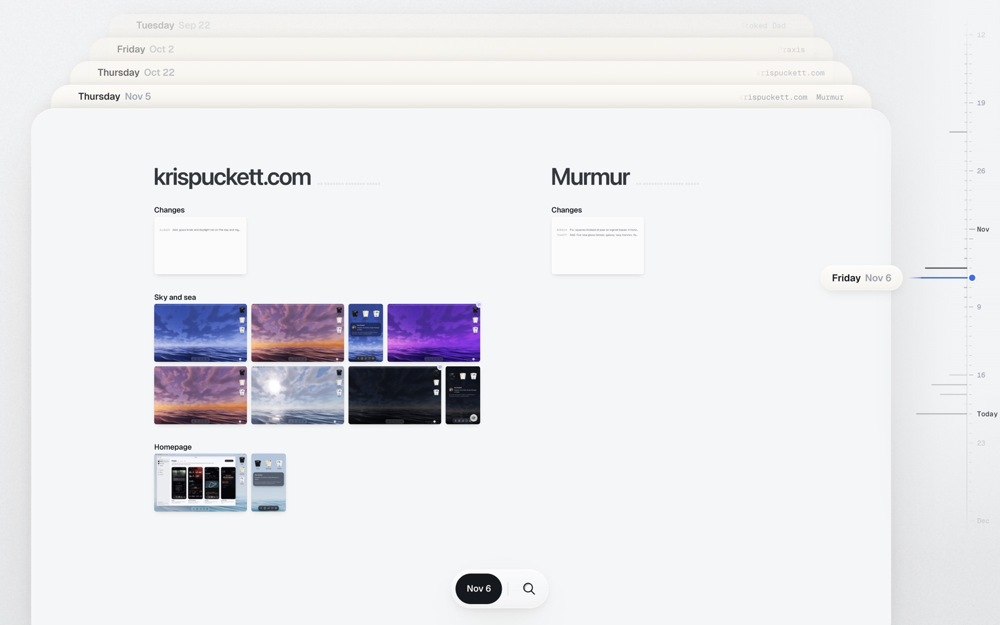

<p align="center">
  
</p>

<h1 align="center">Rounds for Codex</h1>

<p align="center">Everything your Codex sessions make, on one canvas.</p>

[](docs/rounds-film.mp4)

<p align="center"><a href="docs/rounds-film.mp4">Watch the film</a></p>

I run a lot of Codex sessions at once and kept losing track of what each one made. Now it
all lands in one place, and I can leave notes on it.

## Try it

```bash
npx github:krispuckett/rounds-codex --demo
```

The demo is six of my public projects and the real notes I left on them. It runs in its own
folder and doesn't touch your setup.

## What it does

Screens, pages and pushes from every session, sorted by project.



Pin a note on a screen. Send your next message to the chat that made it, and Codex gets the
note, makes the fix and replies.



Drag to compare a screen with the one it replaced.



Step back to any day to see what was made on it.



Search a session by name, or tap a group's title in the timeline, to see only that session's
work, newest first.

The files a session changed sit on a sheet beside its screens. Open one to read every change
line by line, and to see which other sessions changed it too.

Captured work stays on your canvas even after its chat or original files are gone. Posted
HTML pages are saved as snapshots; their external assets are not bundled.

## Set it up

You need a Mac, Node 20 or newer, and Codex with the `codex` command available in your terminal.
Rounds reads the sessions that run on your Mac; sessions in the cloud don't reach it.

```bash
npx github:krispuckett/rounds-codex init
```

This asks before installing an MCP server, a skill and four hooks in Codex, and backs up your
existing settings. Review and trust the hooks in **Settings > Hooks** (or `/hooks` in the CLI),
then reopen your chats. Open the canvas:

```bash
npx github:krispuckett/rounds-codex
```

The canvas opens at [localhost:4798](http://localhost:4798). Keep the terminal running while
using it. The first launch imports your local history in the background.

To update the Codex integration, stop the canvas, run `init` again, and reopen your chats. Your
saved work and notes stay in place.

To take it all out:

```bash
npx github:krispuckett/rounds-codex uninstall
```

## Privacy

Everything stays in `~/.rounds-codex` on your Mac. The canvas listens only on your own machine.
Topic grouping uses post topics and chat names locally, without background model calls.

<details>
<summary>More</summary>

### Tools

Sessions post with `rounds_post` and `rounds_change`, read notes with `rounds_notes` and answer
them with `rounds_reply`. The hooks give each chat its identity, bring it notes with your next
message, capture completed work, and notice successful pushes.

[Setup, storage, history import, and troubleshooting](docs/SETUP.md).

### Keys

| Key | Does |
| --- | --- |
| T | Timeline |
| ← → | Back or forward through the days with work |
| / or ⌘K | Search |
| + − 0 | Zoom in, zoom out, fit everything |
| Space | Hold to pan, or to see the before while comparing |
| Esc | Back out |

Scroll pans and pinch zooms, in the timeline too; scrolling over its rail moves through
the days. Drop an image or an HTML file on the canvas to add it to a project.

### Config

`~/.rounds-codex/config.json`, every field optional:

```json
{
  "projects": [{ "key": "shop", "name": "Shop", "match": ["shop", "storefront"] }],
  "private": ["acme-internal"],
  "port": 4798
}
```

`projects` groups work by words in its session, folder or caption. Anything matching `private`
never shows up. `ROUNDS_CODEX_HOME` and `ROUNDS_CODEX_PORT` override the folder and the port.

### Develop

```bash
npm ci
npm run dev     # the canvas, on :4798
npm run check
npm test        # the integration loop, in temporary directories
```

</details>

## License

A separate port of [Rounds](https://github.com/krispuckett/rounds).

MIT. Made by [Kris Puckett](https://krispuckett.com).
